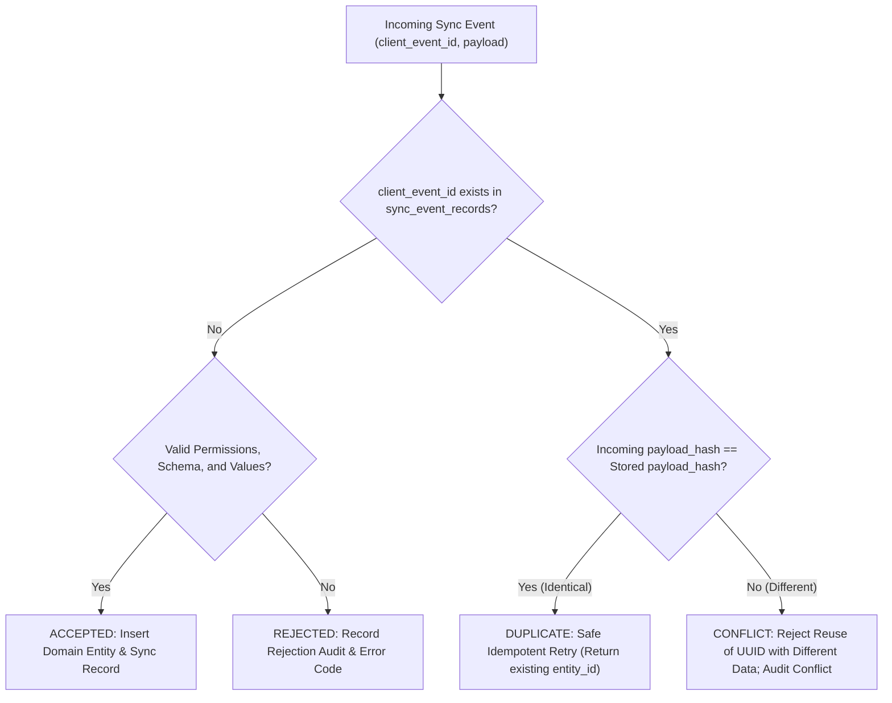

# Offline Synchronization and Batch Ingestion Architecture

High-reliability synchronization protocol for astronaut physiological telemetry, biometric observations, and wellness check-ins recorded in intermittent-connectivity, delayed, or disrupted spaceflight operational environments (e.g. Deep Space Transit, Lunar Surface, Mars Comm Delay, Loss of Signal / LOS periods).

---

> [!NOTE]
> **Scope & Boundaries:**  
> This specification defines the **backend ingestion, reconciliation, and idempotency protocol**. It guarantees secure, bounded, atomic reconciliation of client-uploaded batches. Offline local caching and local device encryption on client flight hardware require separate client-side local storage implementations.

---

## 1. Batch Protocol & Event Envelope

Offline synchronization operates via bounded HTTP batches submitted to `POST /api/v1/sync`.

### Event Ingestion Envelope
Each event submitted in `events: list[SyncEventItem]` must supply:
1. `client_event_id` (UUID): Stable, client-generated event identifier. Serves as the primary idempotency key.
2. `crew_member_id` (UUID): Subject astronaut identifier. Verified against authenticated client token (BOLA prevention).
3. `event_type`: Domain categorization (`MEASUREMENT`, `WELLNESS_CHECK_IN`, `SYMPTOM_CHECK_IN`).
4. `schema_version`: Version string of event payload (strictly `"1.0"`).
5. `client_event_at`: UTC timestamp when event was recorded into client local database.
6. `measured_at`: UTC timestamp when physical physiological observation occurred on subject.
7. `source`: Hardware, sensor model, firmware version, and input method provenance.
8. `payload`: Structured domain data conforming to the respective type specification.

---

## 2. Temporal Guarantees & Clock-Skew Assumptions

Spaceflight communications face orbital propagation latency, relativity, and intermittent drift between spacecraft master clocks and wearable sensors.

| Timestamp Field | Origin Authority | Meaning & Role |
| :--- | :--- | :--- |
| `measured_at` | Biometric Sensor / Subject | Exact time the physiological event took place. Used for clinical baselines, longitudinal trends, and rules. |
| `client_event_at` | Client Flight Software | Time the event was persisted into client's offline SQLite/storage buffer. |
| `server_received_at` | Ground / Vehicle Server | Time the sync batch was received and reconciled. |

### Clock-Skew & Future Timestamp Policy
- **Historical Observations:** Observations recorded hours, days, or weeks in the past during LOS periods are fully accepted and slotted into chronological history without rewriting other records.
- **Future Drift Tolerance:** Client timestamps may exceed server wall-clock time by at most **15 minutes** to tolerate minor local clock drift. Any observation with `measured_at` or `client_event_at` exceeding 15 minutes into the future is rejected with `error_code="invalid_future_timestamp"`.
- **Chronological Non-Overwriting Guarantee:** Observations in `health_measurements` are immutable records. An older measurement that arrives later in time does **not** overwrite a newer measurement; both remain chronologically indexed by `measured_at`.

---

## 3. Database Idempotency & Conflict Resolution Behavior

To guarantee safe, repeatable retries across dropped radio links without creating duplicate observations or corrupting clinical data:

### Idempotency Mechanism
1. Every event is tracked in the `sync_event_records` table with a unique constraint on `client_event_id`.
2. For every payload, a deterministic SHA-256 hash (`payload_hash`) is computed:
   $$\text{payload\_hash} = \text{SHA256}(\text{canonical\_json}(\text{payload}))$$

### Reconciliation State Outcomes

1. **`accepted`**:
   - The event is new, valid, and authorized.
   - The physiological measurement or check-in is persisted, and a `sync_event_records` entry is committed.
2. **`duplicate`**:
   - The event UUID was previously submitted with the exact same payload hash.
   - The server recognizes an idempotent retry (e.g. client re-transmitted after network timeout).
   - Returns existing `entity_id` without creating duplicate records or re-running triggers.
3. **`conflict`**:
   - The event UUID was previously submitted with a **different payload**.
   - An explicit conflict is returned (`error_code="sync_payload_conflict"`).
   - An audit event (`SYNC_PAYLOAD_CONFLICT`) is recorded without exposing Personal Health Information (PHI).
   - Neither payload is overwritten silently.
4. **`rejected`**:
   - The event fails schema validation, clock-skew boundaries, unit compatibility, or astronaut authorization.
   - The specific error code and human-safe explanation are returned in the response.

---

## 4. Partial Batch Success & Atomic Isolation

- Synchronization batches are bounded between **1 and 100 events**.
- Each event is executed inside a nested transaction savepoint (`begin_nested()`).
- If event 1 succeeds, event 2 fails validation, and event 3 is a duplicate:
  - Event 1 is committed (`accepted`).
  - Event 2 returns `rejected` with error details.
  - Event 3 returns `duplicate`.
- Failed events can be corrected and safely retried in subsequent sync attempts without re-uploading accepted events.

---

## 5. Retention Window for Idempotency Records

- `sync_event_records` entries are maintained for a minimum **90-day retention window** (configurable up to multi-year deep space transit mission durations).
- Idempotency records outlive transient retransmission windows to guarantee safe offline batch recovery.

